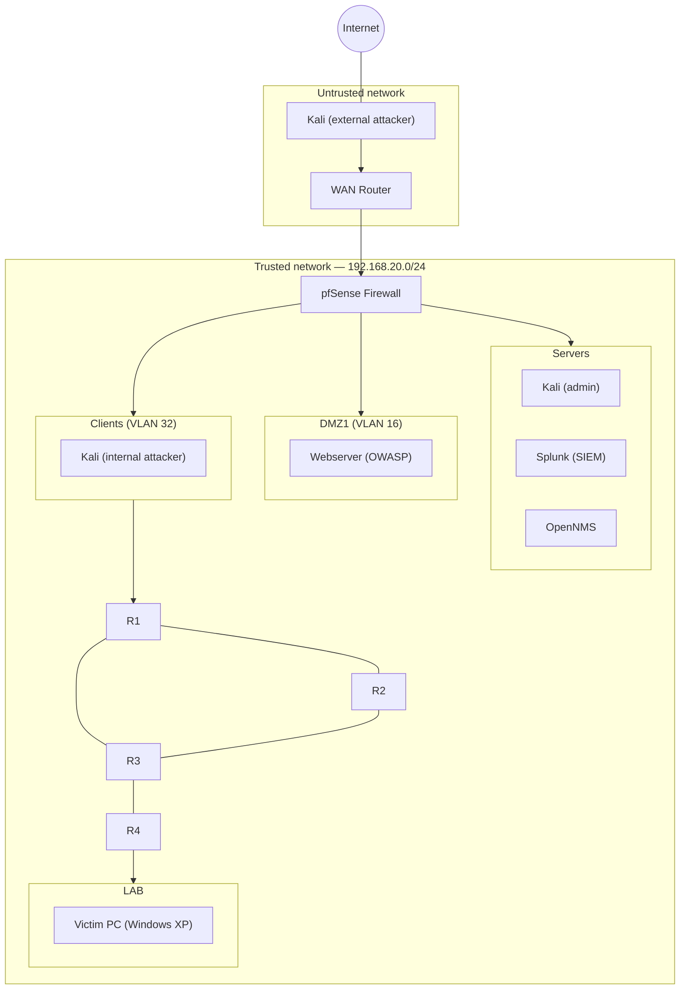

# Network Attack Simulation Lab

Scapy-based attack scripts and a documented virtual network setup (pfSense,
VyOS, Splunk, OpenNMS) demonstrating three classes of network attacks —
reconnaissance, denial-of-service, and SNMP reflection/amplification —
along with their detection and mitigation.

## What it does and why

This project was built as a university networking/security lab. It sets up
a segmented virtual network behind a pfSense firewall, then performs and
analyzes three attack scenarios against hosts inside that network:

- **Reconnaissance**: ARP-based host discovery and a TCP SYN port scan.
- **Denial-of-Service**: a TCP SYN flood against a webserver.
- **SNMP reflection/amplification**: a spoofed SNMP GETBULK request that
  causes misconfigured routers to flood a victim with amplified traffic,
  shown in two variants (routed via VLANs, and via a shared broadcast
  domain).

Each attack is paired with a Splunk detection query (SPL) and a concrete
mitigation step, documented in [`docs/report.md`](docs/report.md).

## Features

- Standalone, runnable Scapy scripts for each attack (no framework, just
  Python + Scapy)
- Splunk SPL queries for detecting each attack in real time
- Firewall- and device-level mitigation steps for each attack
- Full write-up of the underlying network setup (pfSense, VLAN segmentation,
  RIP routing, SIEM, NMS) in [`docs/report.md`](docs/report.md)

## Architecture

Simplified overview of the trusted network segment (derived from the network
topology and addressing table in the original report; see
[`docs/diagrams/`](docs/diagrams/) for the full source diagrams):



Full addressing, VLAN IDs, and firewall rules are in
[`docs/report.md`](docs/report.md).

## Prerequisites

- Python 3.9+
- [Scapy](https://scapy.net/) (installed via `requirements.txt`)
- Root/administrator privileges (the scripts send raw/crafted packets)
- Linux recommended — the original scripts were run on Kali Linux

## Installation

```bash
git clone <this-repo-url>
cd network-attack-simulation-lab
pip install -r requirements.txt
```

## Usage

> ⚠️ **Only run these scripts against systems you own or are explicitly
> authorized to test** — for example inside your own isolated virtual lab
> network, as described in `docs/report.md`. Do not point them at production
> systems, third-party infrastructure, or anything on a network you don't
> control.

```bash
# TCP SYN port scan
sudo python3 src/recon/port_scanner.py <target_ip> <start_port> <end_port>

# TCP SYN flood (DoS)
sudo python3 src/dos/tcp_syn_flood.py <target_ip> <target_port>

# SNMP: measure response/amplification size for a given OID
sudo python3 src/snmp_amplification/oid_analysis.py <snmp_device_ip> <oid>

# SNMP reflection/amplification, routed via VLANs (spoofs <spoofed_victim_ip>)
sudo python3 src/snmp_amplification/attack_vlan_routed.py <spoofed_victim_ip>

# SNMP reflection/amplification, via shared broadcast domain
sudo python3 src/snmp_amplification/attack_broadcast.py <spoofed_victim_ip>
```

The SNMP scripts assume target devices have SNMP v2c enabled with a
read-only `public` community — the (intentionally) misconfigured state
described in `docs/report.md`.

## Configuration

There is no config file — every script takes its target(s) as command-line
arguments (see **Usage** above).

## License

[MIT](LICENSE)
